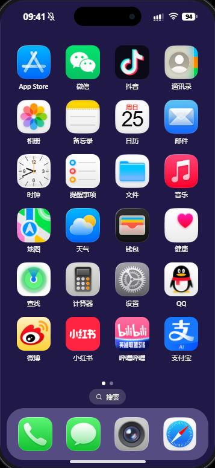
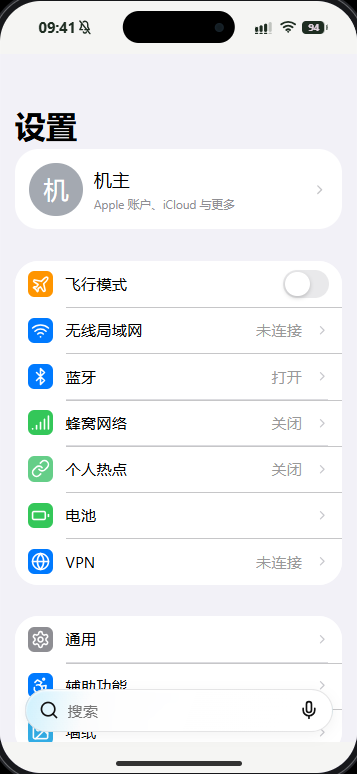
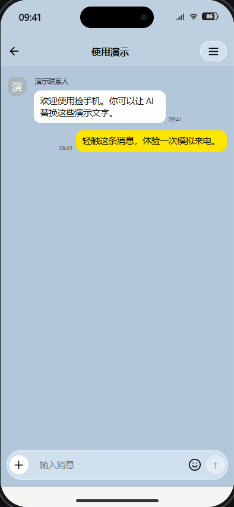

> 当前已接入**第四章《未完成的旋律》**，并改善第三章资料卡与提交反馈。详见 [第三、四章说明](docs/CHAPTER04_AUTHORING_ZH.md)。第三章通关存档可直接续接；当前Demo为文字试听。

> 当前版本已追加**第三章《报名表之外》**：可交互报名表、礼菲与朱家琪、现场记录和女主备忘录。详见 [第三章试玩说明](docs/CHAPTER03_AUTHORING_ZH.md) 与 [备忘录创作规范](docs/MEMO_WRITING_ZH.md)。第二章通关后续接，旧进度保留。

> 当前校园版本：**V0.4 选项式微信＋第二章《关于喜欢这件小事》初稿**。详见 [创作与试玩说明](docs/CHAPTER02_AUTHORING_ZH.md)。已有第一章通关存档可续接，无需重玩。

> 当前校园试玩版本：**V0.3《好天气》**。详见 [交付及试玩说明](docs/V0.3_DELIVERY_ZH.md)。运行 `npm run author:dev` 开始，默认内容位于 `stories/foundation/chapter-01.extensions.json`。旧演示源文件保留。

> **校园创作环境 V0.2**：[中文创作手册](docs/AUTHORING_ZH.md) · [功能盘点](docs/FEATURE_AUDIT_V02.md) · [验证记录](docs/VERIFICATION_V02.md)。先运行 `npm run author:check`，作者预览用 `npm run author:dev`，玩家构建用 `npm run author:build`。下方保留此前版本及原项目信息。

> 校园个性化演示已加入：[试玩、AI 接入与内容编辑说明](docs/CAMPUS_DEMO.md)。默认剧情命令使用 `foundation:*`；完整网页与 AI 服务使用 `npm run campus:serve`。

> 本 Fork 的框架准备入口：先阅读 [准备与启动说明](docs/FOUNDATION_SETUP.md)。使用 `npm run foundation:dev` 打开无剧情的手机；原项目说明保留如下。

# 捡手机 · FoundPhone Studio

《捡手机》是一个可以通过 AI 添加剧情的交互式虚拟手机框架。你不需要重新制作手机界面，只需要准备人物设定、聊天记录和剧情要求，让 AI 填入故事数据。

默认打开完整 App 测试预览：49 个 App 已安装，内页只有中性的测试文字，不含剧情或真实账号。桌面底部为四个 App。`/?preview=test` 也可进入相同测试版本；纯空白入口为 `/?template=blank`。

## 可以做什么

- 使用现成的锁屏、桌面、App Store、通知、控制中心和手机 App 页面。
- 长按桌面调整图标、文件夹和小组件；在手机 App Store 中选择安装 App。
- 添加微信、KakaoTalk 聊天，以及 Instagram、X 等社交内容。
- 添加联系人、照片、备忘录、通知、模拟来电、密码、互动选项和多个结局。
- 通过事件连接不同 App，并在浏览器中保存玩家进度。
- 生成静态网站，分享给朋友；首次加载并完成缓存后，核心剧情可离线运行。

App 库目前有 49 个注册入口。各 App 的页面覆盖不同，并非真实服务客户端，也不代表所有功能或界面均已完整还原。

## 零基础使用

1. 登录 [GitHub](https://github.com/)。
2. 打开本项目仓库，点击右上角 **Fork**，复制到自己的账号。若已启用模板，也可以选择 **Use this template**。
3. 用支持读取和修改项目的 AI 编程工具打开自己的副本，例如 Codex、WorkBuddy 或 Claude Code。
4. 复制下面的提示词，把故事发给 AI。让它先阅读 `AGENTS.md`，优先修改 `stories/template/story.json`。
5. 请 AI 启动预览，亲自测试聊天、密码、电话和每个结局。
6. 按[部署教程](docs/GITHUB_PAGES.md)发布网页。
7. 把生成的网址分享给朋友。

### 复制给 AI

> 我想基于《捡手机》制作自己的互动手机故事。请先指导我 Fork 原仓库，在我的 Fork 中阅读 AGENTS.md 和剧情脚本规范，然后根据下面的故事内容自动生成角色、聊天、App 数据、时间线和剧情事件，运行校验并修复错误。尽量只修改故事数据，不要重写手机 UI。我的故事是：【填写故事】。

也可以提供图片、聊天记录和具体触发要求。请只使用你有权公开的素材，不要提交真实账号密码或私人聊天。

## 本地预览

先安装 Node.js 22，然后在项目目录执行：

```sh
npm ci
npm run story:validate
npm run story:test
npm run story:preview
```

打开终端显示的本地网址。正式构建：

```sh
npm run build
npm run preview
```

上传 `dist/` 的内容即可部署。不能直接双击 HTML 文件运行。

默认故事位于 `stories/template/story.json`；纯空白手机位于 `stories/blank/story.json`，可用 `/?template=blank` 查看。你可以替换演示数据，也可以通过环境变量 `STORY_FILE` 选择其他作品。故事数据与界面代码分离，作品运行时不需要 AI 在线。

## 演示与截图

[在线体验](https://keoyyo85.github.io/FoundPhone-Studio/) · [GitHub 仓库](https://github.com/keoyyo85/FoundPhone-Studio)

| 桌面 | 设置 | 聊天 |
| --- | --- | --- |
|  |  |  |

## 常见问题

**不会写代码怎么办？** 把上面的提示词和故事发给能够修改项目文件的 AI。普通聊天工具若无法访问文件，需要你手动保存它生成的脚本。

**为什么没有全部 App？** 新手机只安装少量 App。打开手机里的 App Store 获取其他 App；作者也可以在脚本的 `installedApps` 中配置。

**为什么修改后还看到旧进度？** 玩家存档与故事分开保存。剧情有较大变化时，让 AI 增加脚本的 `revision`，再重新构建。

**数据保存在哪里？** 玩家进度保存在当前浏览器。换浏览器、清理网站数据可能导致进度丢失；源码 ZIP 不包含浏览器存档。

**能直接填写自然语言吗？** 自然语言由创作阶段的 AI 转成 JSON。框架本身不在运行时调用模型，也不会自动执行脚本中的 HTML 或 JavaScript。

**Fork 后如何上线？** 见[GitHub Pages 教程](docs/GITHUB_PAGES.md)。首次需要在自己仓库中启用 Actions 和 Pages。

## 开发与许可

[AI 创作指南](docs/AI_STORY_GUIDE.md) · [脚本规范](docs/STORY_SCHEMA.md) · [架构](docs/ARCHITECTURE.md)

验证命令：`npm run typecheck`、`npm run lint`、`npm test`、`npm run story:validate`、`npm run story:test`、`npm run build`。浏览器回归使用 `npm run test:e2e`。

项目许可见 [LICENSE](LICENSE)。故事与素材的权利由其作者确认。安装、启动和构建不会自动 Fork、Star 或推送仓库。
